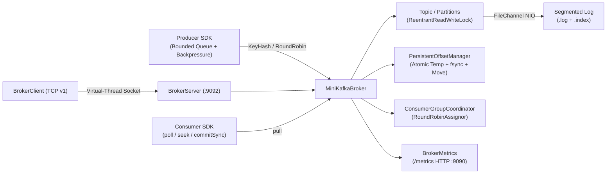

# MiniKafka

[](https://github.com/chirag-xo/MiniKafka/actions/workflows/ci.yml)


A lightweight, Kafka-inspired event streaming broker written from scratch in Java 21 with zero external runtime dependencies.

Implements segmented append-only `FileChannel` logs, sparse offset indexing, CRC32 torn-write recovery, atomic consumer group offset persistence, bounded producer backpressure, consumer group rebalancing, and a versioned binary TCP protocol.

---

## Architecture



---

## Quick Start

Requires **Java 21+** and **Maven 3.9+**.

```bash
git clone https://github.com/chirag-xo/MiniKafka.git
cd MiniKafka

# Run all 149 unit, integration, crash-recovery, and overload tests
mvn test

# Run the interactive end-to-end demo
./bin/live-demo.sh

# Run throughput & latency benchmarks
./bin/benchmark.sh

# Start the TCP broker server (port 9092, data dir ./data)
./bin/minikafka-server.sh 9092 ./data
```

---

## Live Output

### Interactive Demo (`./bin/live-demo.sh`)

```text
✔ Broker initialized with durable segmented storage at: minikafka-live-demo...
✔ Observability /metrics HTTP server running at: http://localhost:9090/metrics
✔ Topic 'order-events' created with 4 partitions.

--- [1] Producing Live Event Stream (Virtual Threads) ---
  [PRODUCE] Key: customer-1   ➜ Partition: 2 | Offset: 0 | Data: {"orderId": 1, "amount": $19.99, "status": "CREATED"}
  [PRODUCE] Key: customer-2   ➜ Partition: 3 | Offset: 0 | Data: {"orderId": 2, "amount": $39.98, "status": "CREATED"}
  ...
  [PRODUCE] Key: customer-0   ➜ Partition: 1 | Offset: 7 | Data: {"orderId": 20, "amount": $399.80, "status": "CREATED"}

--- [2] Consumer Group Scaling & Disjoint Partition Assignment ---
  Consumer-A Assigned Partitions: [order-events-0, order-events-2]
  Consumer-B Assigned Partitions: [order-events-1, order-events-3]

✔ Successfully processed all 20 messages! (Consumer-A: 8, Consumer-B: 12)

--- [4] Live Broker Metrics Snapshot ---
messages_produced_total 20
messages_fetched_total 20
bytes_written_total 1086
produce_errors_total 0
produce_latency_avg_us 3411.55
```

### Test Suite (`mvn test`)

```text
Tests run: 149, Failures: 0, Errors: 0, Skipped: 0
BUILD SUCCESS
```

### Benchmarks (`./bin/benchmark.sh`)

| Workload | Messages | Payload | Threads | Duration | Throughput | P50 | P95 | P99 |
|---|---:|---:|---:|---:|---:|---:|---:|---:|
| In-Memory Produce | 100,000 | 256 B | 8 | 129 ms | **770,444 msg/s** | 2.0 µs | 26.0 µs | 124.0 µs |
| In-Memory Consume | 100,000 | 128 B | 1 | 20 ms | **4,870,832 msg/s** | — | — | — |
| Disk Produce (`fsync`) | 50,000 | 256 B | 4 | 137 s | **365 msg/s** | 10.8 ms | 19.0 ms | 24.0 ms |

---

## Core Design

### 1. Segmented Storage & Crash Recovery
- **Layout:** Each partition writes to rolling `{baseOffset:020d}.log` and sparse `{baseOffset:020d}.index` files (`INDEX_STRIDE = 8`) under `data/{topic}/partition-{id}/`.
- **Record Format:** `[length: 4B][magic: 1B (0x4B)][crc32: 8B][timestamp: 8B][offset: 8B][id][key][value]`.
- **Torn-Write Recovery:** On restart, `LogSegment.recover()` scans from byte 0, verifies magic bytes, CRC32 checksums, and monotonic offsets, truncates any incomplete or corrupt trailing bytes, and rebuilds `.index`. `PersistentPartition` cleans up orphaned `.index`/`.tmp` files and stale empty rolled segments.
- **Retention:** `LogRetentionManager` enforces time-based (`retention.ms`) and size-based (`retention.bytes`) cleanup while always preserving the active segment.

### 2. Atomic Consumer Offsets
- `PersistentOffsetManager` persists committed cursors under `data/offsets/{groupId}/{topic}-{partition}.offset`.
- Commits write to `.offset.tmp`, flush via `FileChannel.force(true)`, and swap via `Files.move(..., ATOMIC_MOVE, REPLACE_EXISTING)` so restarts never observe half-written offset state.

### 3. Producer Backpressure
- `MiniKafkaProducer` enforces a bounded queue capacity (`ProducerConfig`) across `send()` and `sendAsync()` drained by virtual-thread workers.
- Configurable overload policies (`BackpressurePolicy`):
  - `BLOCK_WITH_TIMEOUT` — blocks caller up to `sendTimeout`, then throws `ProducerBufferFullException`.
  - `REJECT_IMMEDIATELY` — fails fast when the buffer is full.
  - `CALLER_RUNS` — throttles callers by running appends on the calling thread.
- Tracks `producer_queue_size`, `producer_queue_utilization`, `producer_rejected_total`, and `producer_timed_out_total`.

### 4. Versioned TCP Protocol
- **Wire Frame:** `[frame_length: 4B][protocol_version: 1B (0x01)][request_type: 1B][request_id: 4B][payload]`
- **Operations:** `PRODUCE (0x01)`, `FETCH (0x02)`, `CREATE_TOPIC (0x03)`, `LIST_TOPICS (0x04)`, `PING (0x05)`, `ERROR (0x7F)`.
- **Hardening:** Enforces `maxFrameSize` (4 MB default) before buffer allocation, validates bounded internal field lengths, returns typed `ResponseStatus` codes (`BAD_REQUEST`, `UNSUPPORTED_VERSION`, `UNKNOWN_REQUEST_TYPE`, `FRAME_TOO_LARGE`, `TOPIC_NOT_FOUND`, etc.), and configures socket read (`SO_TIMEOUT`) and write-stall watchdog timeouts.

---

## Documentation & Scope

- [System Architecture](docs/ARCHITECTURE.md)
- [Architecture Decision Records (ADRs)](docs/DESIGN_DECISIONS.md)
- [Product Requirements](docs/PRD.md)

**Explicit Non-Goals:** Multi-broker clustering (Raft/KRaft/ZooKeeper), exactly-once two-phase commits (targets at-least-once delivery), and external frameworks (Spring, Netty).
