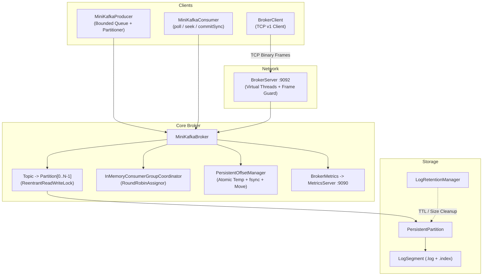
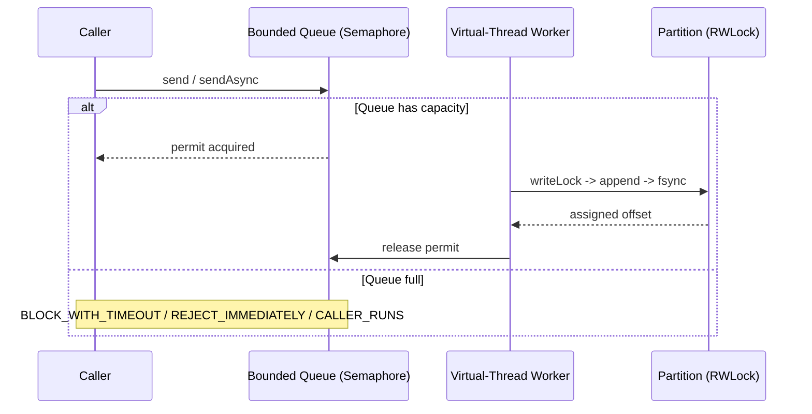

# MiniKafka — System Architecture

## 1. High-Level Layout

I structured MiniKafka in layers so core log and partition logic stays independent of networking and client APIs:



---

## 2. Package Map

| Package | Purpose |
|---|---|
| `model` | Immutable `Message` record with defensive byte-array copying |
| `partition` | `Partition` contract and `InMemoryPartition` |
| `topic` | `Topic` coordinating `0..N-1` independent partitions |
| `broker` | `MiniKafkaBroker` managing topic lifecycle, recovery, metrics, and routing |
| `producer` | `MiniKafkaProducer`, `ProducerConfig`, `BackpressurePolicy`, `ProducerMetrics`, partitioners |
| `consumer` | `MiniKafkaConsumer`, `AutoOffsetReset`, `ConsumerRecords` |
| `storage` | `PersistentPartition`, `LogSegment`, `RecordSerializer`, `LogRetentionManager` |
| `offset` | `OffsetManager`, `InMemoryOffsetManager`, `PersistentOffsetManager` |
| `group` | `ConsumerGroupCoordinator`, `RoundRobinAssignor` |
| `network` | `BrokerServer`, `BrokerClient`, `NetworkProtocol`, `RequestType`, `ResponseStatus` |
| `metrics` | `BrokerMetrics` (lock-free `LongAdder` counters/histogram) and `MetricsServer` |

---

## 3. Storage & Recovery Flow

Each persistent partition maps to `data/<topic>/partition-<id>/` and splits records into rolling segments:

```
data/
├── orders/
│   └── partition-0/
│       ├── 00000000000000000000.log
│       ├── 00000000000000000000.index
│       ├── 00000000000000001024.log
│       └── 00000000000000001024.index
└── offsets/
    └── billing-service/
        ├── orders-0.offset
        └── orders-1.offset
```

### Binary Record & Sparse Index

```
.log record:
+------------+-------+--------+-----------+--------+--------+-----+-------+-----+-------+-------+
| bodyLen 4B | 0x4B  | CRC 8B | ts 8B     | off 8B | idLen  | id  | kLen  | key | vLen  | value |
+------------+-------+--------+-----------+--------+--------+-----+-------+-----+-------+-------+

.index entry (every 8 records):
+--------------------+--------------------+
| relativeOffset 4B  | bytePosition 4B    |
+--------------------+--------------------+
```

**Read path:** Binary search segments by `baseOffset` $\rightarrow$ binary search `.index` for largest `relativeOffset <= target` $\rightarrow$ seek in `.log` $\rightarrow$ linear scan to `fromOffset`.

**Crash recovery:** `LogSegment.recover()` scans from byte `0`, verifies magic bytes, CRC32 checksums, and monotonic offsets, truncates any incomplete or corrupt trailing bytes, and rebuilds `.index`. `PersistentPartition` cleans up orphaned `.index`/`.tmp` files and stale empty rolled segments.

---

## 4. Concurrency & Backpressure



- **Per-Partition Locking:** Each partition owns an independent `ReentrantReadWriteLock`. Writers take the write lock to append and advance `nextOffset`; concurrent readers share the read lock; distinct partitions never block each other.
- **Atomic Offset Commits:** `PersistentOffsetManager` writes to `.offset.tmp`, calls `FileChannel.force(true)`, and swaps via `ATOMIC_MOVE` so a crash mid-commit never corrupts the previous offset.

---

## 5. TCP Wire Protocol (v1)

```
+---------------+------------+----------+------------+--------------------+
| frameLen (4B) | ver (1B=1) | type(1B) | reqId (4B) | payload (variable) |
+---------------+------------+----------+------------+--------------------+
```

- Frames are validated against `HEADER_SIZE` (6 B) and `maxFrameSize` (4 MB default) before allocating payload buffers.
- Every response returns a typed `ResponseStatus` (`OK`, `BAD_REQUEST`, `UNSUPPORTED_VERSION`, `UNKNOWN_REQUEST_TYPE`, `FRAME_TOO_LARGE`, `TOPIC_NOT_FOUND`, etc.) and echoes `requestId`.
- `BrokerServer` handles each connection on a virtual thread with configurable socket `SO_TIMEOUT` reads and a write-stall watchdog timer.
