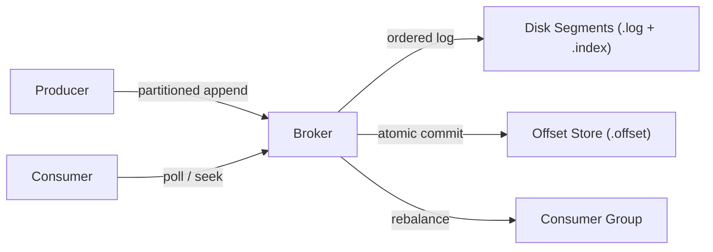

# MiniKafka — Product Requirements

## 1. Overview

I built **MiniKafka** from scratch in Java 21 to understand how an append-only event streaming broker works under the hood—without relying on Spring, Netty, or existing broker libraries.

The goal was to build a single-node broker with real storage, recovery, backpressure, consumer group coordination, and a binary TCP wire protocol, keeping every layer small enough to reason about directly.

---

## 2. Core Requirements

### Topics & Partitions
- Create and delete topics dynamically with $N \ge 1$ partitions.
- Store immutable records (`id`, optional `key`, `value`, `timestamp`, `topic`, `partition`, `offset`).
- Enforce strictly monotonic per-partition offsets ($Offset_{n+1} = Offset_n + 1$).

### Producer & Backpressure
- Route keyed records deterministically to the same partition; round-robin when key is `null`.
- Support synchronous `send()` and asynchronous `sendAsync()` execution.
- Bound producer memory with configurable queue capacity, timeouts, and overload policies (`BLOCK_WITH_TIMEOUT`, `REJECT_IMMEDIATELY`, `CALLER_RUNS`).

### Consumer & Offsets
- Pull-based `poll(Duration)` with configurable `EARLIEST` / `LATEST` reset policies and `seek()`.
- Persist committed group offsets atomically to disk so consumer restarts resume without re-processing committed batches.
- Support consumer groups with automatic round-robin partition assignment when members join or leave.

### Segmented Storage & Crash Recovery
- Store partition logs as rolling `.log` and sparse `.index` segment files via `FileChannel`.
- Verify record integrity with magic bytes and CRC32 checksums.
- Recover valid log prefixes on restart by truncating partial/corrupt trailing records, rebuilding sparse indexes, and cleaning up interrupted segment rollovers.
- Enforce time-based (`retention.ms`) and size-based (`retention.bytes`) segment cleanup while preserving the active segment.

### Networking & Observability
- Serve remote clients over a versioned (`v1`), length-prefixed binary TCP protocol with request IDs, typed `ResponseStatus` codes, frame size limits, and socket read/write timeouts.
- Expose runtime counters, latency histograms, and producer queue utilization over an embedded `/metrics` HTTP endpoint.

---

## 3. Scope Boundaries

To keep the project focused on core broker internals rather than cluster consensus, MiniKafka intentionally excludes:
- Multi-broker clustering, replication, Raft, ZooKeeper, or KRaft.
- Two-phase commits or Exactly-Once Semantics (targets **At-Least-Once** delivery).
- External frameworks or third-party networking/serialization libraries.
